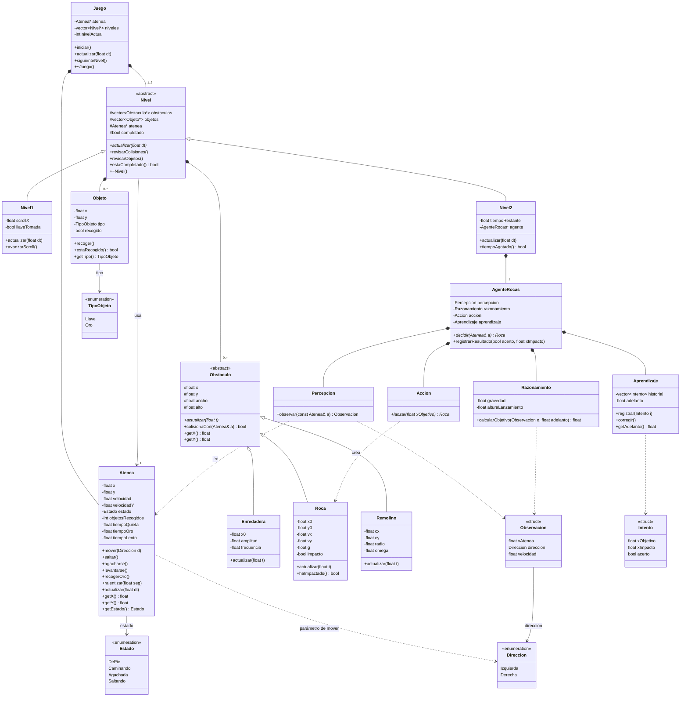

# Diagrama de clases — Momento II (capa lógica)

> Solo capa lógica: las reglas del juego, sin Qt. La capa de GUI se agrega en el Momento III. 

## Diagrama

Cómo leer las flechas: triángulo vacío = herencia; rombo lleno = composición (el todo es dueño de la parte); flecha simple = asociación (usa, no es dueño); flecha punteada = dependencia (usa de paso).

---

## Relación 

|Relación|Tipo|Se lee así|
|---|---|---|
|Juego → Atenea|Composición|"El juego crea a Atenea y la destruye al terminar."|
|Juego → Nivel (1..2)|Composición|"El juego crea los niveles y los destruye al terminar."|
|Nivel → Atenea|Asociación|"Un nivel usa a Atenea, pero no es su dueño; Atenea pasa de un nivel al otro."|
|Nivel → Obstaculo (0..*)|Composición|"Un nivel es dueño de sus obstáculos: los crea y los destruye."|
|Nivel → Objeto (0..*)|Composición|"Un nivel es dueño de sus objetos para recoger."|
|Nivel1, Nivel2 → Nivel|Herencia|"Nivel1 y Nivel2 son tipos de Nivel; cada uno actualiza a su manera."|
|Enredadera, Roca, Remolino → Obstaculo|Herencia|"Cada uno es un tipo de obstáculo con su propia física en `actualizar(t)`."|
|Nivel2 → AgenteRocas|Composición|"El nivel 2 tiene un agente y lo destruye con él."|
|AgenteRocas → Percepcion, Razonamiento, Accion, Aprendizaje|Composición|"El agente está formado por cuatro partes separadas."|
|Percepcion → Atenea|Dependencia|"La percepción lee a Atenea para observarla."|
|Accion → Roca|Dependencia|"La acción crea las rocas que lanza."|
|Aprendizaje → Intento|Dependencia|"El aprendizaje guarda un historial de intentos."|
|Razonamiento → Observacion|Dependencia|"El razonamiento recibe lo que percibió el agente para decidir."|
|Atenea → Estado|Asociación|"Atenea guarda su estado actual, que es uno de los valores de `Estado`."|
|Atenea → Direccion|Dependencia|"`mover()` recibe una `Direccion` como parámetro."|
|Objeto → TipoObjeto|Asociación|"Cada objeto guarda de qué tipo es: llave u oro."|
|Observacion → Direccion|Asociación|"La observación guarda hacia dónde se mueve Atenea."|

---

## Clases

### Atenea

- **Sabe:** posición `x`, `y`; `velocidad` y `velocidadY`; `estado`; `objetosRecogidos`; `tiempoQuieta` (estratégica); `tiempoOro` (justa); `tiempoLento` (para cuando una roca la golpea).
- **Hace:** `mover`, `saltar`, `agacharse`, `levantarse`, `recogerOro` (suma al marcador `objetosRecogidos` y activa `tiempoOro`), `ralentizar(seg)`, `actualizar(dt)`.
- **Idea clave:** no hereda de nada. Es la misma Atenea en los dos niveles.

### Obstaculo (abstracta) y sus hijos

- **Idea clave:** `actualizar(t)` es abstracta: cada hijo calcula su movimiento con su propia ecuación.
- **Enredadera** (nivel 1): péndulo. **Roca** (nivel 2): parabólico. **Remolino** (nivel 2): circular.

### Objeto

- Llave u oro (el pato). Guarda si ya fue recogido.

### Nivel (abstracta), Nivel1 y Nivel2

- **Nivel:** guarda los obstáculos, los objetos y el puntero a Atenea. Detecta choques y objetos, y Atenea reacciona con sus métodos.
- **Nivel1:** vista lateral con scroll; hay que llegar hasta la llave y tomarla para completar el nivel.
- **Nivel2:** vista lateral fija; contrarreloj con `tiempoRestante`; tiene el agente.

### AgenteRocas y sus cuatro partes

- **Percepcion:** observa a Atenea y devuelve una `Observacion` (posición, dirección, velocidad).
- **Razonamiento:** calcula dónde estará Atenea cuando llegue la roca, usando el `adelanto` aprendido.
- **Accion:** crea la `Roca` con `vx`, `vy` y `g` para que caiga en ese punto.
- **Aprendizaje:** guarda cada `Intento` (a dónde apuntó, dónde cayó, si acertó) y corrige el `adelanto`.

### Juego

- Crea y destruye a Atenea y a los niveles, y decide cuándo pasar al siguiente.

---

## Estructuras de datos y memoria dinámica

|Dato|Dónde|Para qué|Memoria|
|---|---|---|---|
|`vector<Nivel*>`|Juego|Guardar los dos niveles|`new` al crear, `delete` en `~Juego()`|
|`Atenea*`|Juego|Crear una sola Atenea|`new` / `delete` en el juego; los niveles solo la usan|
|`vector<Obstaculo*>`|Nivel|Guardar obstáculos de distinto tipo|`new` al crear; `delete` en `~Nivel()`|
|`vector<Objeto*>`|Nivel|Guardar los objetos|`delete` en `~Nivel()`|
|`AgenteRocas*`|Nivel2|El agente del nivel|`new` / `delete` en Nivel2|
|`vector<Intento>`|Aprendizaje|Historial para aprender|Se maneja solo (guarda copias)|
|`struct Observacion`, `struct Intento`|Agente|Pasar datos entre las partes|Sin memoria dinámica|
|`enum class`|Atenea, Objeto|Estados, direcciones y tipos|Sin memoria dinámica|

El destructor de `Nivel` y el de `Obstaculo` deben ser `virtual`, para que al borrar un obstáculo desde un puntero de la clase base se destruya el hijo correcto.

---

## Físicas

| Física             | Ecuación                                     | Parámetros      | Clase      | Nivel |
| ------------------ | -------------------------------------------- | --------------- | ---------- | ----- |
| Péndulo (armónico) | `x = x0 + A·sen(ω·t)`                        | `A`, `ω`        | Enredadera | 1     |
| Parabólico         | `x = x0 + vx·t`; `y = y0 + vy·t + ½·g·t²`    | `vx`, `vy`, `g` | Roca       | 2     |
| Circular           | `x = cx + R·cos(ω·t)`; `y = cy + R·sen(ω·t)` | `R`, `ω`        | Remolino   | 2     |

---

---

